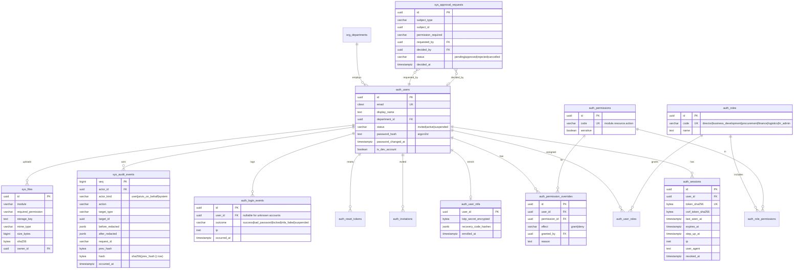
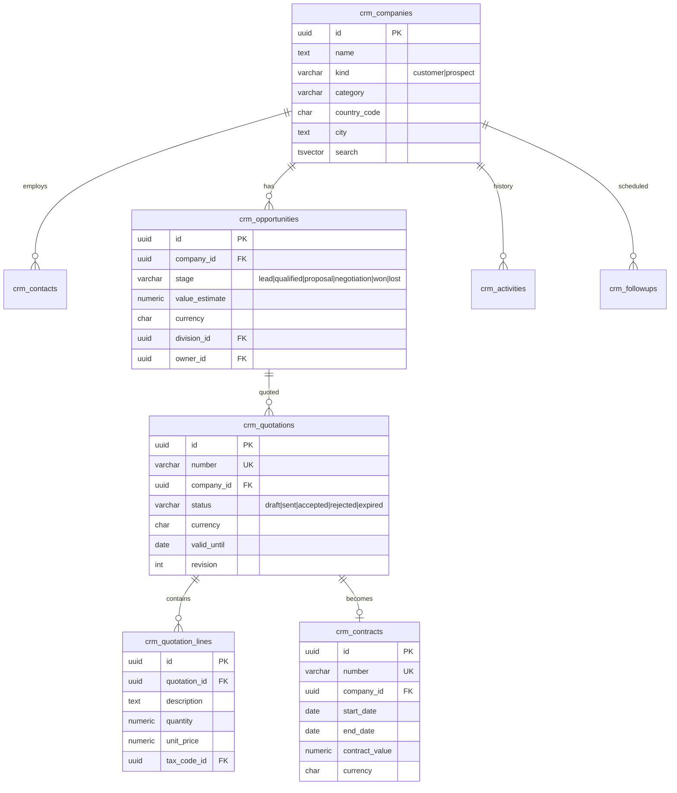
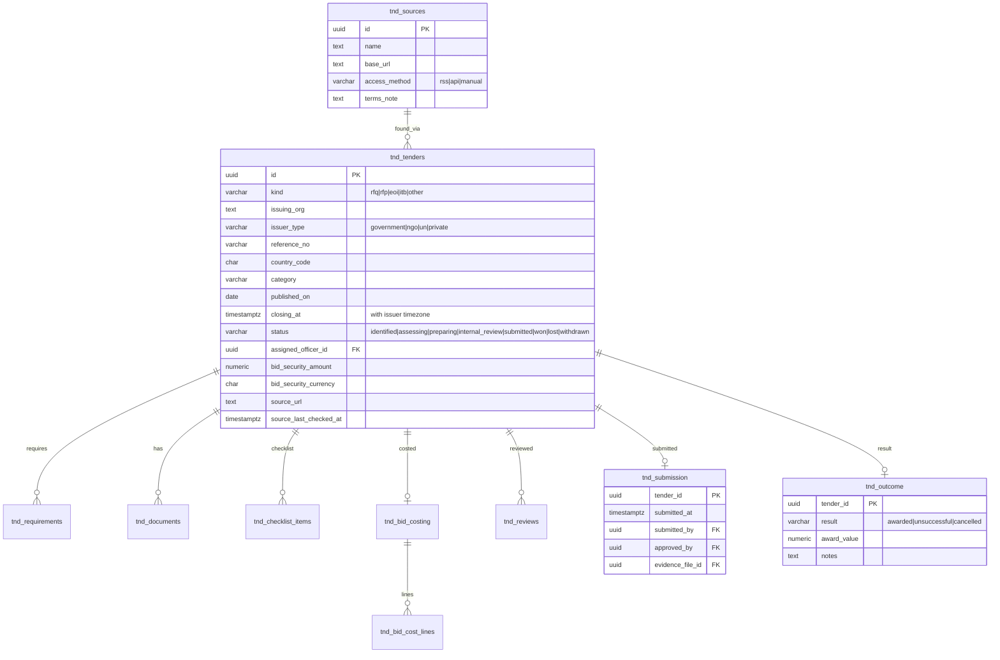
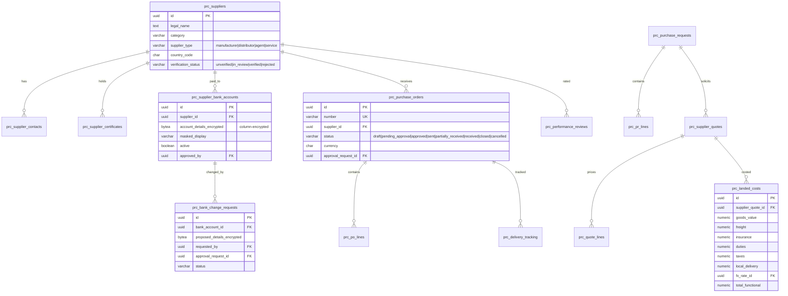
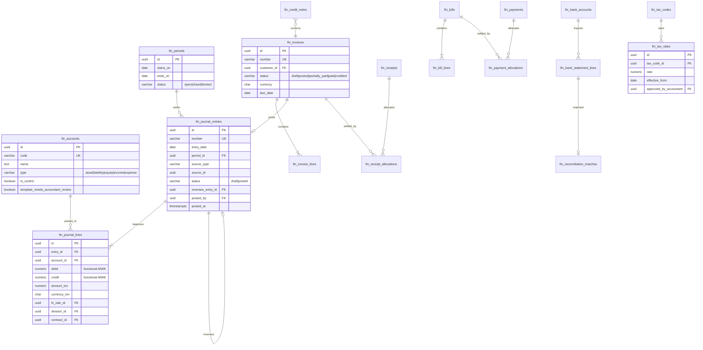
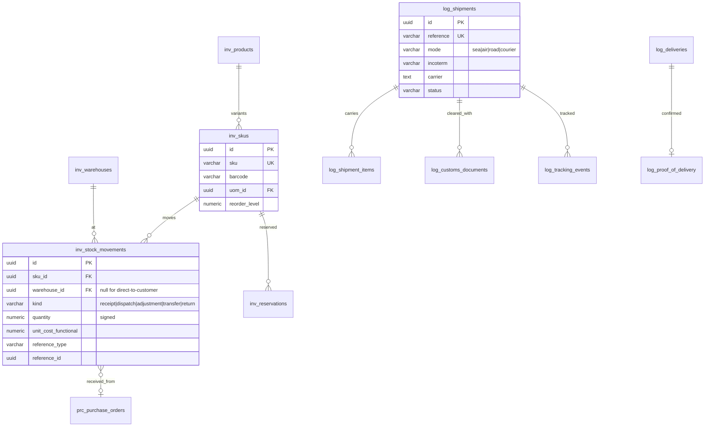
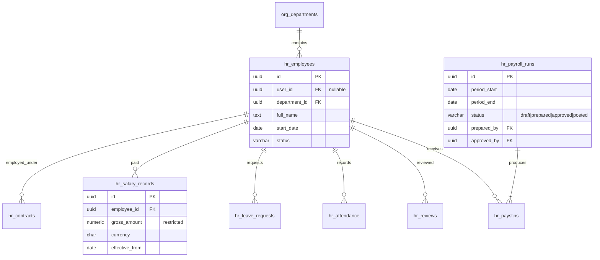
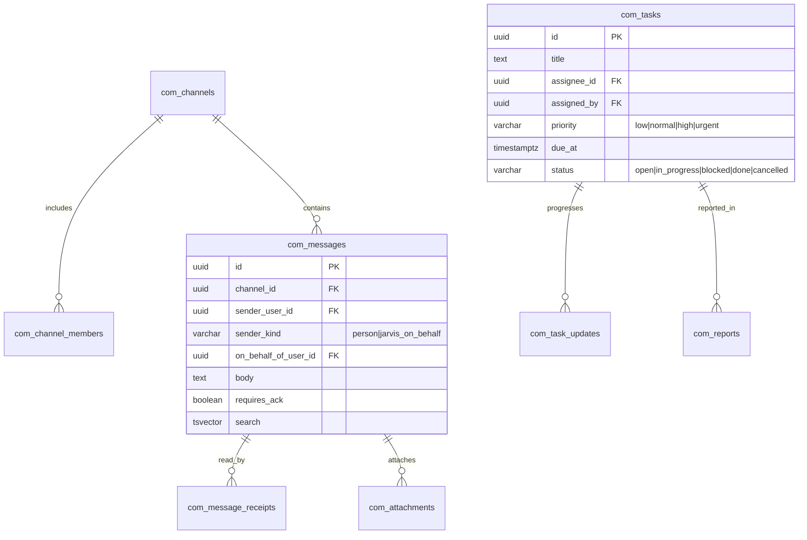

# AVEN GLOBAL database design

- Status: **Stage 0 deliverable, awaiting Director review.** This is the
  logical design. Each stage turns its part into Alembic migrations, and
  details may be refined in that stage's approved plan.
- Implemented today: migration `0001`, `organisation_profile` (Stage 1,
  verified in CI).

## 1. Principles

1. **PostgreSQL 16 is the single system of record.** There is no second
   database. Redis holds only disposable data: cache, rate limits, pub/sub and
   the broker.
2. **Integrity lives in the database:**
   - foreign keys
   - `NOT NULL`
   - CHECK constraints on statuses, currencies and signs
   - unique constraints on document numbers
   - triggers for append-only tables and balanced journals
3. **Never invent business data.** Migrations seed only reference data:
   roles, permissions, currencies, chart-of-accounts *templates* marked for
   accountant review, and units of measure.
4. **Posted financial records are immutable.** Corrections are reversals and
   credit notes. Master data is archived (`archived_at`), not deleted.
5. **Migrations** are linear, reviewed, and reversible where data allows.
   Large changes use expand → migrate → contract. Destructive steps need
   Director approval and a verified backup.

## 2. Conventions

| Item | Convention |
|------|-----------|
| Primary keys | `id UUID DEFAULT gen_random_uuid()` |
| Table names | snake_case, module prefix: `auth_`, `org_`, `crm_`, `tnd_`, `prc_`, `fin_`, `inv_`, `log_`, `hr_`, `com_`, `doc_`, `ai_`, `sys_` |
| Audit columns | `created_at`, `updated_at` (`timestamptz`, UTC), `created_by` and `updated_by` (FK `auth_users`), `version int` (optimistic locking) |
| Money | `NUMERIC(20,4)` plus `currency CHAR(3)` (CHECK in `org_currencies`). Never floating point. |
| Functional currency | MWK. Every financial line stores `amount`, `currency`, `fx_rate_id` and `amount_functional` (MWK). |
| Quantities | `NUMERIC(18,4)` with a `uom_id` |
| Enumerations | `VARCHAR` plus a CHECK constraint (not PG enums, which are easier to evolve) |
| Constraint names | Fixed naming convention (`pk_`, `fk_`, `uq_`, `ck_`, `ix_`), in place since Stage 1 |
| Soft delete | Only for master data (`archived_at`). Transactions are never soft-deleted. |
| Text search | `tsvector` generated columns plus GIN indexes on searchable entities |
| Division and contract tagging | `division_id` on revenue and cost records. `contract_id` or `project_ref` on finance lines for profitability. |

## 3. Platform and security (Stages 1–2)

**Other platform tables:**

- `org_organisation_profile`. This is the Stage 1 `organisation_profile`; it
  will be renamed with an expand/contract migration.
- `org_divisions`: the six proposed divisions are **configuration entered by
  the Director**, not seeded.
- `org_departments`
- `org_currencies`
- `org_fx_rates` (`base`, `quote`, `rate`, `rate_date`, `source`,
  `source_url`, `captured_at`; unique per currency pair, date and source)
- `sys_settings` (system configuration, Director-only)
- `sys_outbox` (domain events)
- `sys_security_alerts`
- `sys_backup_runs` (backup management visibility)
- `sys_number_sequences` (`doc_type`, `year`, `next_value`). Numbers are
  allocated with `SELECT … FOR UPDATE` inside the business transaction, so
  they are gapless and unique.

**Database-level protections:**

- `sys_audit_events` has a `BEFORE UPDATE OR DELETE` trigger that raises an
  error, and the application role has only `INSERT, SELECT` on it.
- A nightly job verifies the hash chain and raises a security alert if it is
  broken.

## 4. CRM, quotations and contracts (Stage 4)

**Other CRM tables:**

- `crm_activities`: meetings, calls, notes and emails logged, plus
  attachments through `sys_files`.
- `crm_followups`: due date, assignee, done.

## 5. Tenders (Stage 5)

Rules:

- A submission requires an approval request decided by the Director. It is
  never automatic.
- Readiness means every mandatory checklist item is done.

## 6. Procurement and suppliers (Stage 6)

Bank details are **encrypted at column level** (an application key held in
secrets). They can be read only with `procurement.supplier_bank.view` (Director
by default). Changes take effect only after the approval request is decided by
a **different** user, with step-up authentication.

## 7. Finance and accounting (Stage 7)

**Invariants (database and service enforced, property-tested):**

- Σ debit = Σ credit per entry: a deferred constraint trigger fires at
  commit.
- No line has both a debit and a credit, and no line is negative.
- A posted entry and its lines are read-only (trigger). Corrections are a new
  entry with `reverses_entry_id`.
- Posting into a `closed` or `locked` period is rejected.
- Invoice, receipt, credit-note, bill and payment numbers are unique and
  gapless per type and year.
- **Invoiced revenue** (posted invoices) and **cash collected** (receipts)
  are separate ledgers and separate reports.
- No tax rate exists in code. Rates come from `fin_tax_rates`, each with
  accountant approval recorded.

## 8. Inventory and logistics (Stage 8)

- Stock balances are derived from movements, which are append-only, plus a
  cached balance table rebuilt by a job and checked against the movements.
- Valuation uses weighted average (proposed; to be confirmed with the
  accountant).
- Direct-to-customer fulfilment uses movements with no warehouse.

## 9. Human resources (Stage 9)

- Salary, payslip and personal-identifier columns are visible only with
  `hr.payroll.view` (Director and HR/Admin).
- Statutory deduction rules are configuration (`hr_statutory_rules`), and
  require professional sign-off.

## 10. Communications (Stage 10)

`sender_kind` and `on_behalf_of_user_id` make AI-generated messages
**structurally distinguishable** from messages the Director sent personally.

## 11. Documents and AI (Stages 11–13)

- **`doc_documents`:** `type`, `number`, `source_type` and `source_id`,
  `version`, `file_id`, `generated_by`, `status`. The table is versioned and
  never overwritten. There are no signature images unless uploaded and
  authorised.
- **AI tables:**
  - `ai_conversations` and `ai_messages`
  - `ai_tool_calls` (tool, category read/prepare/execute, inputs redacted,
    decision, outcome, `approval_request_id`, `audit_seq`)
  - `ai_usage` (tokens, cost, latency, user)
  - `ai_voice_consents` (user, device, consented_at, revoked_at)

## 12. Retention (proposed, Director to confirm)

| Data | Retention |
|------|-----------|
| Audit, login events | 7 years |
| Financial records | At least 7 years, or as the accountant advises |
| Messages | Per the communications policy (Stage 10 decision) |
| Voice audio | **Not stored** (deleted after transcription). Transcripts follow the messages policy. |
| Sessions, reset tokens | Removed after expiry plus 30 days |
