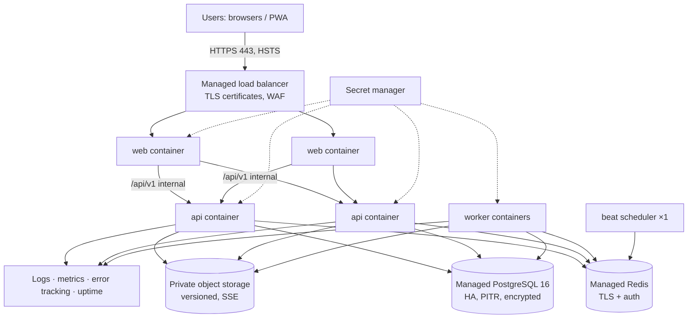

# AVEN GLOBAL deployment architecture

- Status: **Stage 0 deliverable, awaiting Director review.** Nothing is
  deployed. Production infrastructure is built in Stage 14 and only with
  Director approval.

## 1. Environments

| Environment | Purpose | Where | Data |
|-------------|---------|-------|------|
| Development | Daily work | Docker Compose on a developer machine (`make up`) | Development-only labelled data |
| CI | Verification of every push and PR | GitHub Actions on `mhassan6001-web/Avon-Global`, with ephemeral PostgreSQL and Redis services | Throwaway |
| Staging | Release rehearsal, user acceptance testing | Cloud, identical topology to production at a smaller size | Anonymised or development-only data. **Never** production data. |
| Production | Live company use | Cloud, Southern Africa region (§3) | Real data |

**Localhost is never production.** Supabase and Vercel are excluded.

## 2. Production topology

| Component | Specification |
|-----------|--------------|
| web | Next.js standalone image (`frontend/Dockerfile` production target), at least 2 replicas, non-root |
| api | Uvicorn (`--proxy-headers`), at least 2 replicas, non-root, `/health/live` and `/health/ready` probes |
| worker | Celery workers (count scales with queue depth), plus **exactly one** beat |
| PostgreSQL | Managed, multi-AZ standby, point-in-time recovery, encryption at rest, private network only |
| Redis | Managed, TLS, auth, private network |
| Object storage | Private bucket, versioning, server-side encryption, lifecycle rules, no public access |
| Network | Only the load balancer is public. The database, Redis and workers are on private subnets. |

## 3. Hosting provider and region (decision for Stage 14)

A Southern Africa region keeps latency to Lilongwe low and data close.

| Provider | Region candidate |
|----------|------------------|
| AWS | af-south-1 (Cape Town) |
| Microsoft Azure | South Africa North (Johannesburg) |
| Google Cloud | africa-south1 (Johannesburg) |

The managed-service availability, pricing and data-protection terms of each
are **to be verified at Stage 14**. The Director chooses.

## 4. CI/CD and release

1. **Pull request:** CI (lint, types, unit, integration, migrations, startup,
   build, security scans) must be green.
2. **Merge into `main`:** done by the Director.
3. **Build:** immutable images tagged with the commit SHA, plus SBOM and image
   scan.
4. **Deploy to staging:** run the migration job, smoke tests, and the e2e
   suite against staging.
5. **Director approval** to promote.
6. **Production:**
   - the migration job runs first (expand-only changes)
   - then a rolling update of api, web and workers
   - then smoke tests
   - then automatic rollback if health checks fail

## 5. Database migration strategy

- Alembic, one linear history. `alembic check` in CI blocks model/migration
  drift.
- **Expand → migrate → contract** for every non-additive change, so each
  release works with both the previous and the next schema version.
- Long data backfills run as resumable jobs, not inside migrations.
- **Destructive operations** (drop or rename with data) need Director
  approval, a fresh verified backup, and a tested rollback script.
- Migrations run as a separate release job, never on application start in
  production. (Dev compose auto-migrates for convenience only.)

## 6. Backups and disaster recovery

| Item | Policy |
|------|--------|
| PostgreSQL | Continuous WAL / PITR (RPO ≤ 15 min) plus daily encrypted snapshots, 35-day retention, monthly copy to a second region |
| Object storage | Versioning plus cross-region replication of critical buckets |
| Restore tests | **Quarterly** full restore into an isolated environment, with integrity checks: row counts, ledger balances, audit hash chain. Results are recorded in `sys_backup_runs` and visible to the Director (module K). |
| RTO | ≤ 4 hours, with a runbook in `DISASTER_RECOVERY.md` (Stage 14) |
| Key management | Backup encryption keys in the provider KMS, with separate access from the application role |

## 7. Secrets

- **Store:** the provider secret manager in production. `.env` (git-ignored)
  only in development. Secrets are never committed, logged or exposed to the
  browser.
- **Inventory** (as of the planned stages):
  - `DATABASE_URL`
  - `REDIS_URL`
  - `SESSION_SECRET` / `TOTP_ENCRYPTION_KEY` / `FIELD_ENCRYPTION_KEY`
    (Stage 2)
  - `ANTHROPIC_API_KEY` (Stage 11)
  - STT/TTS keys (Stage 12)
  - `PICOVOICE_ACCESS_KEY` (Stage 12, **supplied by the Director at the end**)
  - email credentials (Stage 13)
  - object-storage credentials or role (Stages 2 and 14)
- **Rotation:** documented per secret. Encryption keys support versioned
  rotation (key ID stored with the ciphertext).

## 8. Observability

- **Logs:** structured JSON (Stage 1), shipped to the provider log service,
  with request-ID correlation. Secrets are redacted (in place).
- **Metrics:** request rate, error rate and latency (p50/p95/p99), queue
  depth, task failures, database connections, AI usage and cost.
- **Error tracking:** a hosted error tracker (vendor decided in Stage 14),
  with PII scrubbing.
- **Uptime:** external checks on `/health/live` and `/health/ready`, with
  alerts to the Director.
- **Security alerts** (module K): lockouts, unusual logins, audit-chain
  verification failures, backup failures.

## 9. Rollback procedures

| Failure | Action |
|---------|--------|
| Bad application release | Redeploy the previous image tag. Expand-only migrations make this safe. |
| Bad migration (pre-contract) | Run the documented down-migration, or a forward-fix release |
| Data corruption | PITR restore to a timestamp into a new instance, verify, then switch over. Director approval required. |
| Region outage | Restore from cross-region snapshots, using the DR runbook |

## 10. Stage 14 production-readiness gate

The full checklist is created in Stage 14 (`PRODUCTION_CHECKLIST.md`). The
headline items:

- HTTPS and HSTS
- secrets in the manager
- backups running **and a restore tested**
- monitoring and alerts live
- the permission matrix suite green
- a financial reconciliation test passed
- the AI tool permission suite green
- voice confirmation tested
- mobile responsiveness verified
- user acceptance tests signed off
- **explicit Director approval to deploy**
