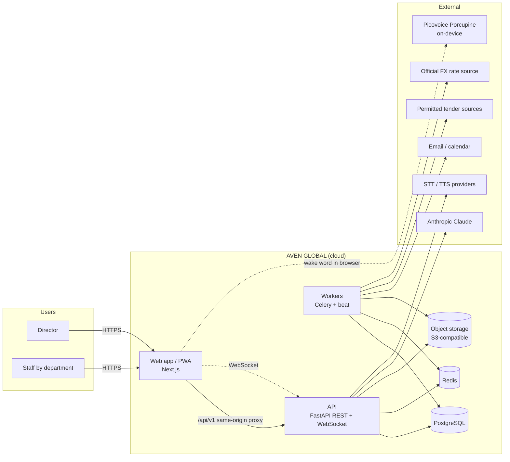
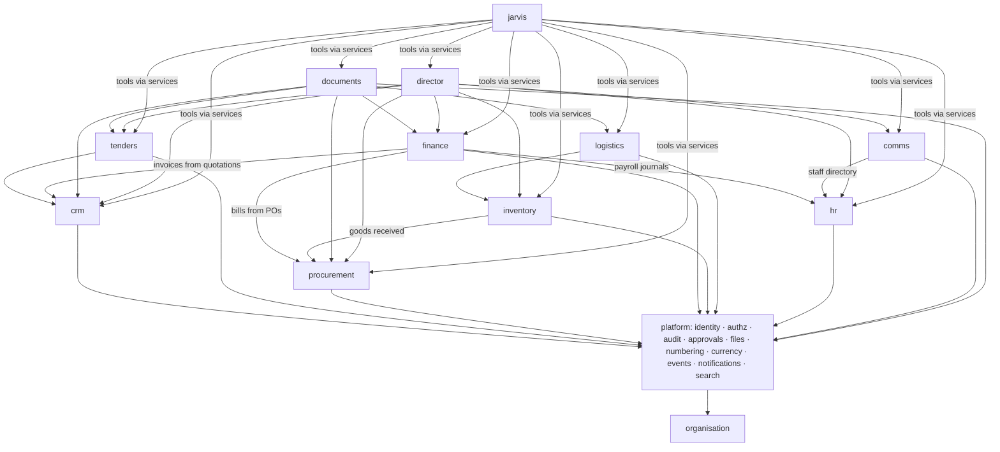
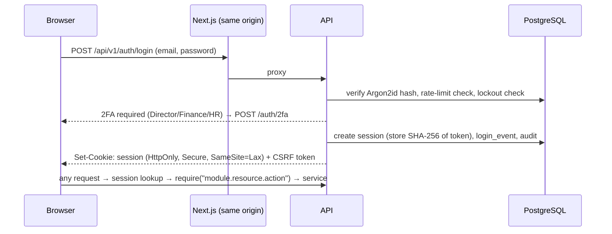
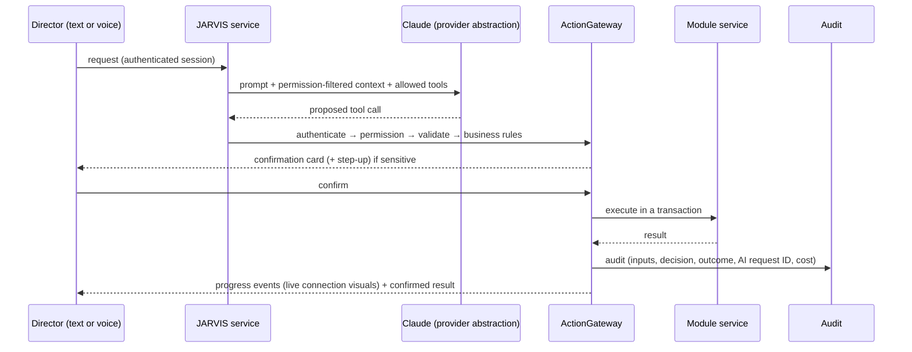

# AVEN GLOBAL system architecture

- Status: **Stage 0 deliverable, awaiting Director review.** It replaces the
  earlier `MASTER_ARCHITECTURE.md`, which was written from the incomplete
  Stage 0 text.
- Sources:
  - Stage 0 specification: `docs/stage-0-specification.md` (complete text)
  - the master project instructions
  - `docs/director-stage-plan.md`
  - `docs/jarvis-design-specification.md`
  - the Director's decisions recorded in `PROJECT_STATUS.md`
- Related documents:

| Topic | Document |
|-------|----------|
| Data model | `DATABASE_DESIGN.md` |
| Security | `../security/SECURITY_MODEL.md` |
| AI | `AI_ARCHITECTURE.md` |
| Voice and audio | `VOICE_AND_SOUND.md` |
| Visual design | `DESIGN_SYSTEM.md`, `REFERENCE_IMAGE_SPECIFICATION.md` |
| Hosting | `DEPLOYMENT_ARCHITECTURE.md` |
| External services | `INTEGRATION_STRATEGY.md` |

---

## 1. Product and clients

AVEN GLOBAL is one centralised, cloud-hosted business operating system for a
Malawi-based international procurement, supplies, sourcing, import/export and
distribution company.

- "2050" is a visual direction only, never part of the name.
- The legal company name and registration status are configuration
  (`organisation_profile`).
- Nothing about the company's customers, suppliers, staff, tenders, licences
  or finances is invented.

| Client | Delivery |
|--------|----------|
| Windows and macOS | Modern browsers (Chrome, Edge, Safari, Firefox). Installable PWA. |
| Phones (iOS, Android) | Responsive PWA (Stage 15). Native apps assessed afterwards. |
| Tablets | Dedicated layouts at 768–1199 px |

**All clients use one backend, one database and one set of business rules.**
No business logic runs only on a client.

## 2. System context



## 3. Logical architecture: modular monolith

One API codebase (ADR-0001, accepted). There are no microservices unless a
future ADR documents a concrete reason.

### 3.1 Module package layout (fixed for every module)

```text
backend/app/modules/<module>/
  models.py    SQLAlchemy models (tables prefixed per DATABASE_DESIGN §2)
  schemas.py   Pydantic request/response models
  service.py   business rules, transactions, permission checks (the module's public API)
  router.py    HTTP endpoints → service functions only
  events.py    domain events published / subscribed
  tools.py     JARVIS tools wrapping service functions (Stage 11+)
  tests/       unit + integration tests
backend/app/platform/   shared services (§3.3)
backend/app/core/       config, logging, errors, middleware (Stage 1, in place)
```

**Boundary rules:**

- Modules call each other only through another module's `service.py`, or
  react to domain events. They never touch another module's tables.
- Routers contain no business logic.
- JARVIS tools call services, never models.

### 3.2 Business modules (Stage 0 A–K)

| Module | Package | Capabilities | Stage |
|--------|---------|--------------|-------|
| A. Director Command Centre | `director` | Overview, revenue and expenses, cash position, profitability, outstanding invoices, supplier liabilities, active tenders, pending approvals, staff performance, alerts and business intelligence | 4 (grows as modules arrive) |
| B. JARVIS AI | `jarvis` | Voice and text, BI, daily briefings, reports, task management, authorised actions, business-wide search, staff-communication assistance | 11–12 |
| C. CRM and Sales | `crm` | Customers, prospects, contacts, pipeline, quotations, contracts, follow-ups, history | 4 |
| D. Tender Management | `tenders` | Government, NGO and UN opportunities, documents, eligibility, deadlines, compliance checklists, bid costing, submission tracking, awards and unsuccessful bids | 5 |
| E. Procurement and Suppliers | `procurement` | Suppliers, verification, quotations, purchase requests and orders, approval workflows, tracking, landed cost, supplier performance | 6 |
| F. Finance and Accounting | `finance` | Invoices, receipts, payments, expenses, cashbook, debtors, creditors, bank reconciliation, P&L, balance sheet, cash flow, multi-division profitability, reporting | 7 |
| G. Inventory and Logistics | `inventory`, `logistics` | Stock, warehouses, movements, purchase receipts, shipments, customs documents, deliveries, reorder alerts, valuation | 8 |
| H. Human Resources | `hr` | Employee records, contracts, attendance, leave, payroll, performance, assignments, departments | 9 |
| I. Staff Communications | `comms` | One-to-one and department messaging, Director announcements, tasks, daily reports, acknowledgements, follow-ups, attachments. **AI-generated messages clearly labelled.** | 10 |
| J. Document Centre | `documents` | PDF, Excel and Word; quotations, invoices, POs, tender documents, contracts, business correspondence | 13 (finance PDFs in 7) |
| K. Administration and Security | `admin` + `platform` | User management, roles, individual permissions, audit logs, **security alerts**, **backup management**, **system configuration** | 2 (users, roles, audit), 14 (backups), alerts across 2 and 14 |

### 3.3 Shared platform services (`app/platform/`)

| Service | Responsibility | Stage |
|---------|----------------|-------|
| identity | Login, Argon2id, sessions, invitations, reset links, 2FA, step-up | 2 |
| authz | Permission catalogue, role and override evaluation, `require()`, field masking | 2 |
| audit | Append-only, hash-chained audit events and login events | 2 |
| approvals | Approval requests, separation of duties (`ensure_not_self_approval`) | 2 (primitive) |
| security_alerts | Lockouts, unusual logins, permission-denied spikes, audit-chain failures → Director alerts | 2 (events), 14 (rules) |
| organisation | Legal name, registration, divisions, currencies, system configuration | 1–2 |
| files | Validated uploads, private object storage, signed and audited access | 2 |
| numbering | Gapless per-type, per-year document numbers | 4/7 |
| currency | Currencies (MWK functional; USD, ZAR, ZMW), dated FX rates with source | 4/7 |
| events | In-process domain events plus transactional outbox (§7) | 4 |
| notifications | In-app, WebSocket, web push, email | 3/10/13/15 |
| search | PostgreSQL full-text search, permission-filtered | 4 |
| jobs | Celery tasks and schedules | 4/5 |
| ai_gateway | Provider abstraction, tool registry, ActionGateway, usage ledger | 11 |
| speech | STT/TTS interfaces, wake-word configuration | 12 |

## 4. Module dependencies



**Build-order consequence:** the stage order (2 → 15) follows these arrows.
Where a module needs one built later (for example the Director dashboard
needing finance figures), its panels show "No data yet" until that module
exists. The figures are never estimated.

## 5. API strategy

- **REST over HTTPS**, JSON, versioned by path (`/api/v1`). Breaking changes
  go into `/api/v2`, and v1 is supported in parallel for at least one release.
- **Resources:** plural nouns, nested at most one level
  (`/crm/customers/{id}/contacts`). Actions that are not CRUD use explicit
  sub-resources (`POST /finance/invoices/{id}/post`,
  `/approvals/{id}/decision`).
- **Contract:**
  - Pydantic schemas generate the OpenAPI spec.
  - The frontend TypeScript client is generated from OpenAPI in CI, so the
    API and UI types never drift.
- **Reads:**
  - cursor pagination (`?limit=&cursor=`)
  - explicit filter parameters
  - `?sort=`
  - field masking applied server-side according to the caller's permissions
- **Writes:**
  - an **`Idempotency-Key`** header on every create that has financial or
    external effects; replays return the original result
  - **optimistic concurrency** through a `version` column and an `If-Match`
    header; a mismatch returns 409
  - a CSRF token header (Stage 2)
- **Errors:** one envelope, `{"error": {code, message, details?, request_id}}`
  (in place since Stage 1).
- **Real-time:** `/api/v1/ws` (cookie-authenticated). Messages carry
  `type`, `channel`, `payload` and `event_id`. The client re-syncs over REST
  after reconnecting, because PostgreSQL is the source of truth.
- **Limits:** per-user and per-IP rate limits (Redis), request body size
  limits, and a 30 s server timeout. Long work is handed to jobs.

## 6. Authentication and permission architecture (summary)

Full design: `SECURITY_MODEL.md` and `docs/stage-2-plan.md`.



- **Department-scoped roles** (Director decision): only the Director sees
  everything. Every other user sees only their department's section.
  Exceptions are individual, audited overrides granted by the Director.
- **Separation of duties:** no one approves their own restricted request. For
  Director-initiated restricted requests, the second approver is to be
  decided in Stages 6–7.

## 7. Event and job architecture

- **Domain events** (for example `invoice.posted`, `po.approved`,
  `tender.deadline_approaching`) are written to an **outbox table** in the
  same transaction as the business change. A worker publishes them to
  Redis/Celery.
  - This gives at-least-once delivery, and consumers are idempotent.
  - A crash can never record a change without its event, or an event
    without its change.
- **Celery with a Redis broker, plus beat.** It runs reminders, deadline
  alerts, document rendering, imports, FX checks, backup verification and
  security-alert rules.
  - Task results that matter are stored in PostgreSQL.
  - Retries use exponential backoff, and failed tasks go to a dead-letter
    record.
  - *Alternatives:* Dramatiq or arq would be simpler, but are not adopted
    because no requirement drives a change.

## 8. AI execution workflow (summary)

Full design: `AI_ARCHITECTURE.md`.



## 9. Voice and audio architecture (summary)

Full design: `VOICE_AND_SOUND.md` (approved).

- **Wake word:** Picovoice Porcupine runs on-device in a Web Worker
  (**paid licence**; the AccessKey is supplied by the Director at the end).
  It is off by default and opt-in with recorded consent, and push-to-talk is
  always available.
- **Pipeline:** audio is captured only after the wake word or a push-to-talk
  press → server-side STT → JARVIS → streaming TTS (CINEMATIC voice) →
  interruptible playback.
- **Audio engine:** Web Audio, one `AudioContext`, buses for master,
  interface, notification and JARVIS voice. Presets: IMMERSIVE (default),
  Balanced and Quiet. Sound starts only after the first user gesture.
- **Platform limit:** web and PWA listening works in the foreground only. No
  background or locked-screen listening is promised.

## 10. Testing strategy

| Layer | Tooling | What it proves | Runs |
|-------|---------|----------------|------|
| Unit | pytest, node:test | Pure logic: config, errors, permission evaluation, calculations | Every push |
| Integration | pytest on **real PostgreSQL 16 and Redis 7** (CI services) | Endpoints, transactions, constraints, migrations, error envelope | Every push |
| Permission matrix | Generated pytest suite | Every protected endpoint × every role × anonymous × suspended | Every push (from Stage 2) |
| Route coverage | pytest | Every route declares a permission requirement | Every push (from Stage 2) |
| Finance invariants | pytest + Hypothesis (property-based) | Journals always balance, no edits after posting, numbering is gapless and unique, FX conversion is consistent | Stage 7 onward |
| Migrations | `alembic downgrade base → upgrade head → check` | Reversibility, no model/migration drift | Every push |
| Contract | OpenAPI generation, TS client compile | API and UI agree | Every push (from Stage 3) |
| End-to-end | Playwright against the real stack | Sign-in, 2FA, key workflows, mobile viewports | Every PR (from Stage 2) |
| Visual fidelity | Playwright screenshots against `design-references/` | The reference QA procedure (REFERENCE spec §7) | Stage 3 onward |
| Accessibility | axe-core in Playwright, keyboard scripts | WCAG 2.2 AA, reduced motion, high contrast | Stage 3 onward |
| Performance | Lighthouse CI, k6 for the API | LCP, long tasks, p95 latency | Stage 3 and Stage 14 |
| Security | ruff-S, bandit, pip-audit, npm audit, OWASP ZAP baseline, secret scanning | Known-vulnerability and code-pattern checks | Every push (ZAP from Stage 14) |
| Voice and audio | Scripted microphone fixtures, autoplay policy tests, real-device runs | Acceptance criteria WW, MP, VO, SC, SV and PC | Stages 3 and 12 |

**Reporting rule:** only executed results are reported. CI publishes the
pytest, migration, mypy, frontend-test and build summaries as GitHub
annotations on each commit. Merging into `main` is the Director's decision.

## 11. Non-functional targets (proposed)

| Area | Target |
|------|--------|
| API latency | p95 < 300 ms for reads and < 800 ms for writes, excluding AI, documents and imports |
| Availability | 99.5% monthly at launch |
| Recovery | RPO ≤ 15 min, RTO ≤ 4 h. Quarterly restore tests (DEPLOYMENT §6). |
| Accessibility | WCAG 2.2 AA |
| Front-end performance | LCP < 2.5 s on a mid-range Android over 4G. 60 fps animations. No long tasks over 50 ms. |
| Security baseline | OWASP ASVS Level 2 |

## 12. Risks and technical limitations

| # | Risk or limitation | Impact | Mitigation |
|---|--------------------|--------|------------|
| R1 | Background and locked-screen wake word is impossible on iOS and Android web | Hands-free only while the app is open | Documented, runtime detection, push-to-talk, native assessment in Stage 15 |
| R2 | Porcupine licence key not yet available | The wake word cannot be tested end to end | Engine behind an interface. Push-to-talk ships first. Key goes into secrets before Stage 12 sign-off. |
| R3 | Statutory tax and payroll rules (Malawi, South Africa, Zambia) not yet confirmed | Wrong tax or payroll | Configuration-only rules plus **mandatory sign-off by a qualified accountant** recorded in the system before live use |
| R4 | The build workspace cannot install packages | Local runs are limited | **Resolved:** GitHub CI is the verification environment |
| R5 | AI cost and latency | Budget overrun, slow answers | Usage ledger, per-user caps, streaming, caching of read-only briefings |
| R6 | Prompt injection through documents, emails or tender texts | Unwanted actions | ActionGateway enforcement, confirmations, untrusted-content marking |
| R7 | Reference images are low-resolution AI renders | Pixel-exact matching is impossible | Fidelity judged on composition, proportion, colour and density (REFERENCE spec) |
| R8 | Third-party tender sources may forbid scraping | Legal risk | Permitted sources only. Terms are checked before integration. |
| R9 | Connectivity in Malawi (bandwidth, outages) | Poor experience | PWA caching of the shell, lean bundles, retry and offline banners. Writes need connectivity, with no offline accounting. |
| R10 | Single Director as approver | Bottleneck. Self-approval is impossible for Director-initiated requests. | Nominated second approver (Stages 6–7), delegation rules |
| R11 | "JARVIS" name association | Trademark risk | Original voice and visuals. Legal check before commercial launch. |
| R12 | Rich motion graphics (Director request) against performance and accessibility | Jank, motion sickness | Motion budgets, GPU-friendly transforms, intensity setting, reduced-motion paths, performance CI |

## 13. Unresolved decisions

| Decision | Needed by |
|----------|-----------|
| Hosting provider and Southern Africa region | Stage 14 |
| Error-tracking and monitoring service | Stage 14 |
| Email provider and sending domain | Stage 13 |
| STT/TTS providers and voice auditions | Stage 12 |
| Wake phrase | Stage 12 |
| Porcupine AccessKey (Director supplies) | Stage 12 sign-off |
| Second approver for Director-initiated restricted requests | Stage 6 |
| Official FX rate source and update frequency | Stage 7 |
| Payroll and tax rules, with an accountant appointed for sign-off | Stages 7 and 9 |
| SMS or WhatsApp notifications wanted? | Stage 13 |
| Communications retention period | Stage 10 |
